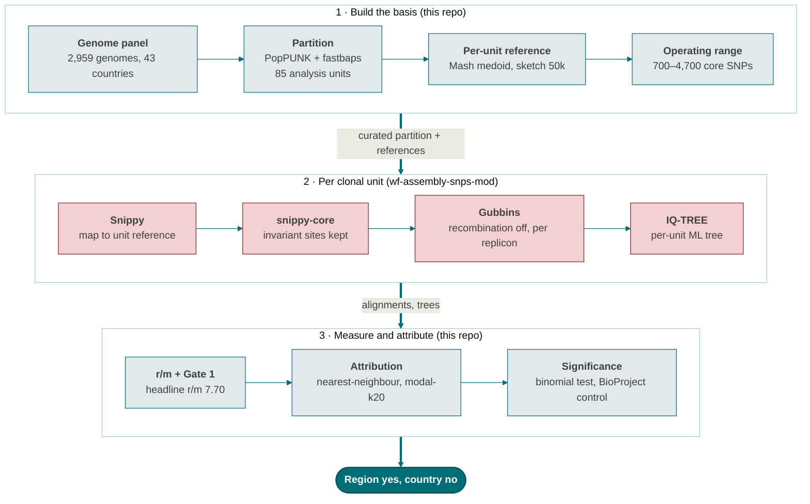

# Where was this patient exposed?

**An illustrated overview of the melioidosis genomic exposure-attribution method and what it found.** For the technical README, build instructions and the workflow modifications, see [README.md](README.md).

---

## The question

*Burkholderia pseudomallei* causes melioidosis and is a US Tier 1 Select Agent. When a case arrives with no travel history, the place of exposure has to be inferred from the genome. Locally acquired cases in Mississippi and a presumptive focus in Georgia have made that a domestic question for United States laboratories.

This work measures how accurately a genome places where a patient was exposed, at sub-national, country and regional scales, on a global panel of **2,959 analysed genomes from 43 countries**. The answer is reported by geographic scale rather than as a single claim.

## How the pipeline works

Three stages run in this repository (panel, partition, calibration). The Nextflow workflow `wf-assembly-snps-mod` calls variants and removes recombination per clonal unit. The results come back here for attribution scoring and diagnostics.

## The method in four parts

**1. From one province to a global question.** The exposure-origin question began with a single-province melioidosis study in Nakhon Phanom, Thailand. Answering it for a case anywhere means comparing the genome against a global reference set, so the panel was built out to 2,959 genomes across 43 countries, the public record joined with locally added isolates.

**2. A ruler you can trust.** Recombination is detected per clonal unit with Gubbins, which only measures anything on a population of the right diversity. Gubbins publishes no divergence ceiling, so the usable range was measured rather than assumed: outside roughly **700 to 4,700 mean pairwise core SNPs** the recombination rate is not a measurement. Below the floor it cannot be detected, above the ceiling the estimate collapses. A low rate is therefore a detection failure, not a clonal unit, which is the single most important thing to know when reading any result here.

**3. What the ruler measured.** On the 47 units inside that window the recombination-to-mutation ratio is **r/m = 7.70**, heavy recombination that confirms a global *B. pseudomallei* panel is not one clonal background and must be partitioned before any tree is built. The all-unit median of 5.51 mixes measurements with detection failures and is never quoted as the rate.

**4. How close is close enough.** Attribution turns genomic distance into an exposure call, scored under a holdout that removes same-country references and same-source outbreak isolates, so no case is scored against its own epidemiological neighbors. Region is recoverable, country is not. The findings below say at what scale the call stops being reliable.

> A narrated four-part video series covering this material is available from the authors.

## What it found

| scale | result | detail |
|---|---|---|
| **Regional** | **89.1%**, works | 41 of 46 cases (95% CI 76.4 to 96.4) against a 45.7% baseline, p < 0.001. Asia versus elsewhere recovered without error. |
| **Country** | **21.7%**, not above chance | 10 of 46 cases (95% CI 10.9 to 36.4) against a 26.1% baseline, p = 0.80. Sub-national failed outright at 0 of 5. |
| **2021 aromatherapy outbreak** | placed in **South Asia** | Correct with those genomes held out (p < 0.001). It could not separate India from the rest of South Asia (p = 0.351), reproducing the boundary the CDC investigation reached. |
| **Resolution** | **not the limit** | In the Nakhon Phanom series, 19 relapse pairs differed by 1 to 14 SNPs and one reinfection pair by 1,102, so the ceiling is signal, not resolution. |

**The conclusion is to report genomic exposure attribution by geographic scale.** A laboratory can state that a case is consistent with acquisition in South Asia. It cannot yet name the country, and these data do not support doing so.

## Data governance

No isolate-level data appears here or anywhere in the repository. *B. pseudomallei* is a Tier 1 Select Agent and the study metadata is re-identifiable for rare cases. This page carries the narrative, the method and the headline figures only. See [README.md](README.md#no-isolate-level-data-in-this-repository-by-design) for the full policy.
