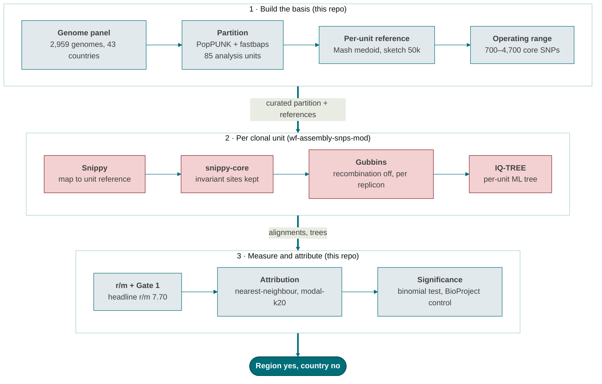

# B. pseudomallei recombination-aware SNP phylogeny

Analysis and orchestration code for a recombination-aware SNP phylogeny of
*Burkholderia pseudomallei*, built to answer one question: **how accurately can a
genome place where a melioidosis patient was exposed, and at what geographic
scale does that stop working?**

The motivation is clinical and epidemiologic. *B. pseudomallei* is a US Tier 1
Select Agent, and when a case arrives with no travel history the exposure origin
has to be inferred from the genome. Locally acquired cases in Mississippi and a
presumptive focus in Georgia have made that a domestic question for United States
laboratories. This project measures the accuracy of that inference at
sub-national, country and regional scales, on a global panel of 2,959 analysed
genomes drawn from 43 countries.

This repository holds the surrounding analysis: panel construction, partitioning,
reference selection, operating-range calibration, diagnostics, attribution
scoring, and the orchestration and monitoring used to drive the runs. The
Nextflow workflow that performs variant calling and recombination inference is a
separate repository, `wf-assembly-snps-mod`, described below.

## No isolate-level data in this repository, by design

**No assemblies, alignments, trees, metadata tables, cluster memberships or
samplesheets are tracked here.** *B. pseudomallei* is a Tier 1 Select Agent, and
the study metadata joins accession to isolation location, collection date and
exposure label, which is re-identifiable for rare cases.

`.gitignore` therefore **denies everything by default** and re-admits only source
code and documentation, at the top level, by extension. Subdirectories are not
re-admitted at all. Every output, work directory and bundle lives in one.

Before any push:

```bash
git ls-files | xargs -r du -ch | tail -1   # total tracked size
git ls-files                                # read the whole list
```

`git add -f` bypasses all of it. Do not use it without checking what you are
forcing.

## Where the workflow came from, and why it had to change

### Origin

The variant-calling and recombination workflow is a fork of
[`bacterial-genomics/wf-assembly-snps`](https://github.com/bacterial-genomics/wf-assembly-snps),
a Nextflow pipeline that builds a core-genome SNP phylogeny from a set of
assemblies. The fork lives at
[`PHemarajata/wf-assembly-snps-mod`](https://github.com/PHemarajata/wf-assembly-snps-mod),
and its manifest reads `author = "Christopher A. Gulvik, PHemarajata"`. The
tooling ancestry is shared with CDC, which is a strength of the method rather
than a footnote.

### Why the upstream pipeline was not enough

Upstream `wf-assembly-snps` detects recombination with Gubbins run once across
the whole input set. Gubbins finds recombination as unusually SNP-dense regions
against a **clonal** background, so it only works on a population of the right
diversity. A global *B. pseudomallei* panel is not one clonal background. It
spans many PopPUNK strains, recombination is heavy (in-window r/m of 7.70), and a
single Gubbins run across the collection sits well outside the range where the
tool measures anything.

Four problems followed from that, and each drove a modification.

1. **Recombination has to be removed per clonal unit, not globally.** The panel
   is partitioned first, and Gubbins runs inside each unit. That partitioning
   (PopPUNK then fastbaps) is a heavy, memory-bound step better done outside the
   per-unit SNP workflow, so the workflow needed a way to accept an
   externally-derived partition rather than re-deriving one internally.

2. **Gubbins publishes no divergence ceiling,** so the usable range had to be
   measured rather than assumed. Outside roughly **700–4,700 mean pairwise core
   SNPs** the r/m estimate is not a measurement. Below the floor recombination
   cannot be detected, above the ceiling the estimate collapses.

3. **Reference selection at this diversity needed a larger Mash sketch.** The
   upstream default sketch size is too coarse to choose a good per-unit mapping
   reference across global diversity.

4. **The pipeline lost units silently and was not reproducible.** Gubbins drew an
   unseeded random seed for RAxML, RAxML rejects a seed of zero, and the failed
   unit was dropped rather than failed because the workflow runs with
   `errorStrategy 'ignore'`. A separate CRLF and SIGPIPE bug could make a run
   report success while doing nothing.

### What was modified

| modification | what it does | why |
|---|---|---|
| **`bp` profile** | raises the Mash sketch size to **50,000** (k = 21) and sets BP-specific parameter and resource defaults | reference selection across global diversity (problem 3) |
| **Curated mode** | accepts `--cluster_assignments` and `--cluster_references`, and skips in-workflow Mash clustering, medoid selection and tree grafting | drive the run from an externally-derived partition (problem 1) |
| **`--split_replicons`** | runs Gubbins per replicon within each unit | recombination inference is replicon-specific in a multi-replicon genome |
| **`--gubbins_skip_starting_tree`** | skips the IQ-TREE fast starting tree inside Gubbins | performance, the reported run's largest single saving |
| **`gubbins_seed`** (PR #6, `0543892`) | passes `--seed` at all five Gubbins call sites | closes the silent unit loss (problem 4) |
| **`gubbins_deterministic`** (PR #7, `4fd7b22`) | forces single-threaded Gubbins | makes a run seed-reproducible, since thread count, not the seed, is the dominant source of run-to-run variation |
| **CRLF and SIGPIPE fixes** (PR #5) | pins `lineterminator="\n"` on every CSV writer and drains the pipe instead of `\| head -1` | removes a bug that reported success while doing nothing |
| **Invariant-site handling** | retains invariant sites through `snippy-core`, passes `--invariant-site-correction` and `--filter-percentage 25` to Gubbins | correct branch lengths on a recombination-filtered alignment |

A separate point, recorded in the methods but worth flagging here: the reported
production run predates the two determinism parameters, so it reproduces
**empirically** (an independent re-execution diffs clean) but is not itself
seed-reproducible. See `DETERMINISM_DEMONSTRATION_2026-09-04.md`.

## What the pipeline looks like now

Three stages run in this repository (panel, partition, calibration), the Nextflow
workflow runs the per-unit SNP and recombination analysis, and the results come
back here for attribution scoring and diagnostics.



The partition feeds the workflow as two files, `curated_L1v4c_clusters.final.tsv`
and `curated_L1v4c_refs.final.tsv`. In curated mode the workflow takes those as
given, so no clustering happens inside the run.

## Reported run, pinned

All reported numbers come from one run. The pin below is read out of the run's
own artifacts, not reconstructed. The full pin, the verbatim command line and the
limits of what it proves are in `PRODUCTION_RUN_PIN_2026-08-24.md`.

| | |
|---|---|
| Pipeline | `wf-assembly-snps-mod`, tag `v1.0.5-mod` = commit `79ab645` |
| Nextflow | 25.04.6, build 5954 |
| Run / session | `agitated_coulomb` / `c90e1105-...` |
| Basis | **85 units, 2,340 genomes** (`FINAL_BASIS_2026-08-22/`) |
| Control | DGX A100 run `insane_jennings`, 88 units, cross-hardware reproducibility |

An independent re-execution from `79ab645` (2026-08-25) diffs clean against the
reported figures: Gate 1 of 47 units with median r/m 7.70, per-unit r/m identical
for 81 of 84 comparable units, per-unit alignment distances identical for 85 of
86 units (`REPRO_RESULT_2026-08-26.md`).

The authoritative software and version table is `METHODS_DRAFT_2026-08-19.md`
§2.12.13, because two tables in the drafts disagree on a version and the
as-run table is the one to trust.

## Usage

This repository is analysis code. It does not run the Nextflow workflow and does
not contain data. Two things you can do here.

**Drive or reproduce a workflow run.** The orchestration scripts
(`run_*.sh`) call `wf-assembly-snps-mod` with the pinned profile and parameters.
`run_full_workflow.sh` runs the whole panel. `run_wf_curated_L1v4c.sh` and its
siblings run the curated-mode partition. Paths inside them are the original
workstation paths and have to be adjusted for a new host.

**Regenerate the quotable numbers**, given the data files (which live outside the
repository, on the working copy that moved to the Mac on 2026-09-14):

```bash
python3 freeze_basis_bp.py      # verifies the frozen basis, exits non-zero on drift
python3 generate_numbers.py     # writes NUMBERS.tsv, every quotable figure
```

`freeze_basis_bp.py` exits non-zero on drift, so run it first and stop if it
fails. Other scripts cover specific results: `grouping_test_bp.py` (the
attribution ladder), `attribution_significance_bp.py` (exact binomial test and
confidence interval, with a `--selftest`), `resolution_curve_bp.py` (the
resolution curve), and `context_snps_bp.py` with `context_report_bp.py` (the
recurrence series).

## Where to start reading

**Start with `INDEX.md`**, which says what is authoritative for each question and
which documents look current but are superseded. `STATE_2026-09-02.md` is the
canonical snapshot behind it, and it and `NUMBERS.tsv` win when documents
disagree.

## Two working conventions that explain most of the code

**Check per-item values, never infer from a summary line.** Every serious defect
in this project produced plausible output: a CRLF line terminator that made a run
report success while doing nothing, a RAxML crash that surfaced as "Unable to fit
model to data", ONT assemblies that passed every automated gate.

**A clean exit does not mean every unit succeeded.** The workflow runs with
`errorStrategy 'ignore'`. Verification compares units *requested* against units
that actually produced output, per unit, before any number is quoted. A unit
count of 171 rather than 172 is the known signature of the unseeded-Gubbins bug,
not evidence of a different result.

**A low r/m is a detection failure, not a clonal unit.** The single most
important thing to know when reading these results. Outside the 700–4,700 SNP
window the r/m estimate is not a measurement, and the all-unit median of 5.51
(which mixes measurements with detection failures) must never be quoted as the
recombination rate. The headline is 7.70, measured on the 47 in-window units.
